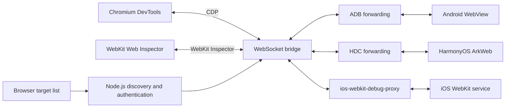

# cdp-native

[中文](README.md) | English

This guide describes version 0.1.0. Panel compatibility should be verified on your target devices.

## 1. Tool introduction

cdp-native is a local debugging service for mobile web content. Node.js runs the service, a browser displays the target list and debugging frontend, and the mobile device executes the inspected page.

| Target | Connection | Debugging frontend | Protocol |
| --- | --- | --- | --- |
| Android WebView | ADB | Bundled Chromium DevTools | CDP |
| HarmonyOS ArkWeb | HDC | Bundled Chromium DevTools | CDP |
| iOS WKWebView / Safari | ios-webkit-debug-proxy | WebKit Web Inspector, prepared at startup | WebKit Inspector |
| Existing CDP HTTP endpoint | Direct connection | Chromium DevTools | CDP |

The service discovers debuggable pages, aggregates targets across processes, supports device and process filtering, and maintains local port forwarding. The target list refreshes approximately every three seconds. Debugging features include JavaScript breakpoints, stepping and variable inspection, plus DOM, Console and Network features supported by the frontend and target engine.

“Native” refers to connecting directly to device debugging interfaces. This tool does not debug Java, Kotlin, Swift, Objective-C or ArkTS application code, enable debugging in third-party apps, or bypass application permissions.

## 2. Why use this tool

- **One entry point for three platforms:** discover mobile pages and launch the appropriate debugging frontend from a local browser page.
- **Less connection setup:** detect connection tools, discover debugging sockets and maintain forwarding automatically.
- **Multiple process support:** aggregate pages on the selected device or narrow the list by device and application process.
- **Inspect pages running on real devices:** use the engine's debugging protocol to investigate mobile WebView behavior.
- **Reuse existing tooling:** provide local tool paths, an external iOS proxy or an existing CDP endpoint.

It is intended for developing and testing applications with web debugging enabled. Use platform development tools for native application code.

## 3. How to use

### 3.1 Requirements and quick start

Use Node.js 20 or newer. From a source checkout:

```sh
npm ci
npm link
cdp-native
```

Alternatively, start directly with `npm start`. If the corresponding version is published to npm:

```sh
npm install -g cdp-native@0.1.0
cdp-native
```

Connect and unlock your device, authorize debugging, and open the page inside the application. The CLI opens the browser and passes its generated access token automatically. Select **Inspect** next to a target. With `--no-open`, open the complete URL printed in the terminal. Press Ctrl+C to stop.

The CLI listens on `127.0.0.1:8080` by default. Set `CHII_CDP_TOKEN` to a fixed token of at least 16 characters if needed; otherwise each launch generates a random token.

### 3.2 Android

Enable USB debugging, authorize the computer, and enable WebView debugging in the application:

```java
WebView.setWebContentsDebuggingEnabled(true);
```

Keep the target WebView page open, then run:

```sh
cdp-native --device-type adb
cdp-native --device-type adb --adb-serial SERIAL --adb-package com.example.app
cdp-native --adb-path /path/to/adb --no-download --no-open
```

ADB detection checks explicit configuration, SDK locations, PATH and cache. If missing, the tool downloads Google Platform-Tools on supported platforms: macOS x86-64/arm64, Windows x64 and Linux x64. The default cache is `~/.cache/cdp-native/<platform>-<architecture>`; override it with `CHII_ADB_CACHE`.

### 3.3 HarmonyOS

Enable and authorize USB debugging, and allow ArkWeb debugging:

```ts
webview.WebviewController.setWebDebuggingAccess(true);
```

```sh
cdp-native --device-type hdc
cdp-native --device-type hdc --hdc-serial SERIAL --hdc-package com.example.app
cdp-native --device-type hdc --hdc-path /path/to/hdc
```

HDC detection checks explicit configuration, common SDK/DevEco locations, PATH and cache. Automatic downloads use a fixed third-party package with SHA-256 verification and support macOS x86-64/arm64 and Windows x64. Install SDK tools yourself on Linux and other unsupported platforms. Use `CHII_HDC_CACHE` to override the cache.

The default `auto` mode selects a unique ADB/HDC device. If multiple candidates exist, specify the device type and serial. Once selected, the service retains that device and transport instead of switching after a disconnect. `auto` does not independently enable iOS.

### 3.4 iOS

Unlock the device, trust the computer and enable Safari Web Inspector. WKWebView applications must also permit inspection, for example:

```swift
if #available(iOS 16.4, *) {
    webView.isInspectable = true
}
```

```sh
cdp-native --device-type ios
```

Startup checks the WebKit frontend and prepares it if missing, including when using an external proxy. Preparation requires Git and access to GitHub. To prepare it ahead of time:

```sh
cdp-native setup:webkit
```

The frontend is installed under `public/webkit` by default and reused on later launches. The npm package does not include this directory or the Windows iOS proxy ZIP. Use `--webkit-frontend /path/to/UserInterface` or `CHII_WEBKIT_FRONTEND` to select another location. `--no-download` prevents automatic preparation and reports an error if the frontend is missing.

For offline source preparation, set `CHII_WEBKIT_SOURCE` and `CHII_WEBKIT_KIT_SOURCE` to local WebKit and ios-safari-remote-debug-kit source directories. Downloads fail after 60 seconds without effective transfer or a five-minute step timeout; check Git connectivity and proxy settings before retrying. `CHII_IOS_PROTOCOL_VERSION` selects a protocol version available in the source.

On macOS, install the proxy using Homebrew:

```sh
brew install ios-webkit-debug-proxy
cdp-native --device-type ios
```

On macOS arm64, setup and iOS startup can install a missing proxy through an existing Homebrew installation. Intel Mac users are prompted to install it. Detection checks PATH and architecture-appropriate Homebrew locations. `--no-download` prevents automatic installation at startup.

Without an external proxy URL, iOS mode prepares and starts its own proxy process. Windows x64 downloads a SHA-256-verified proxy package and requires Apple Mobile Device Support. Other platforms can reuse an installed proxy or supply a download manifest using `--ios-proxy-manifest`.

To manage the proxy yourself, run these commands in separate terminals:

```sh
# Terminal 1
ios_webkit_debug_proxy --no-frontend
```

```sh
# Terminal 2
cdp-native --device-type ios --ios-proxy http://127.0.0.1:9221
```

The service does not manage an externally configured proxy process. To display iOS pages alongside the selected ADB/HDC device, omit `--device-type ios`:

```sh
cdp-native --ios-proxy http://127.0.0.1:9221
```

Select **Inspect · WebKit**. All discovered iOS devices are shown by default; filter with `--ios-serial UDID`. Verify the required panels on real devices because frontend and system protocol versions can differ.

### 3.5 Common options

| Option | Purpose |
| --- | --- |
| `--port 8090` | Change the local service port; default: 8080 |
| `--device-type auto/adb/hdc/ios` | Select device mode; default: auto |
| `--adb-path` / `--hdc-path` | Set a connection tool path |
| `--adb-serial` / `--hdc-serial` | Select a device |
| `--adb-package` / `--hdc-package` | Filter sockets using an application process name |
| `--ios-proxy` | Set an external proxy device-list URL |
| `--ios-proxy-path` / `--ios-proxy-manifest` | Set the proxy executable or download manifest |
| `--ios-serial` / `--webkit-frontend` | Filter iOS devices or select frontend resources |
| `--cdp http://127.0.0.1:9222` | Connect to an existing CDP endpoint, skipping ADB/HDC preparation |
| `--no-download` | Disable automatic tool and frontend downloads |
| `--no-open` | Do not open the browser automatically |

Environment variables include `CHII_ADB_PATH`, `CHII_ADB_SERIAL`, `CHII_ADB_PACKAGE`, and their `CHII_HDC_*` equivalents, plus `CHII_IOS_PROXY`, `CHII_IOS_SERIAL`, `CHII_WEBKIT_FRONTEND` and `CHII_CDP_URL`.

### 3.6 Troubleshooting and maintenance

| Symptom | What to check |
| --- | --- |
| Waiting for a device | USB connection, unlock status, authorization, `adb devices` or `hdc list targets` |
| Device connected but no pages | Open the page, enable application web debugging and check process filters |
| Multiple devices reported | Specify the device type and serial |
| iOS proxy connection fails | Check the proxy process and device-list port |
| WebKit preparation fails | Check Git, GitHub access, proxy settings and directory permissions |
| Frontend missing with `--no-download` | Run `cdp-native setup:webkit` first or specify an installed frontend |
| iOS targets appear but panels fail | Verify frontend/system protocol compatibility on the device |
| Inspect disconnects after app restart | Wait for refresh and inspect the new target |
| Tool download fails | Check networking or provide a local tool path |

Source maintenance commands include `npm test`, `npm run build` and `npm run pack:native`. Automated checks do not replace device testing of discovery, inspection, breakpoints, stepping, variables, reconnection and application restarts.

The WebKit frontend includes compatibility patches from a GPL-3.0 project, while WebKit source files retain their own licenses. Preserve licenses and `PROVENANCE.txt` when preparing or distributing these resources. Connection tools and proxies have their own licenses and runtime dependencies.

## 4. How it works

### 4.1 Transport and debugging protocols

ADB and HDC handle device access, shell commands and port forwarding. CDP and WebKit Inspector carry debugging commands and events. WebSocket transports these messages through the local service.



### 4.2 Android and HarmonyOS

For Android, the service starts ADB, lists authorized devices and reads `/proc/net/unix` to discover `webview_devtools_remote*` sockets. Optional process filtering uses `pidof`. It creates forwarding with `adb -s SERIAL forward tcp:0 localabstract:SOCKET`, queries `/json/list`, and retains page targets with WebSocket URLs.

HarmonyOS uses `hdc list targets`, the same socket discovery approach and `hdc -t SERIAL fport tcp:PORT localabstract:SOCKET`. A temporary local listener identifies a free port; forwarding retries up to three times on port conflicts. HDC server recovery is attempted for relevant connection failures and timeouts.

DevTools connects to the local bridge, which connects to the selected upstream target. Both platforms use CDP; there is no HDC-to-CDP translation. Commands contain fields such as `id`, `method` and `params`; responses correlate by ID and events report engine activity. The device engine executes debugging operations, not Node.js.

### 4.3 iOS

The service requests `/json` on the proxy device-list endpoint, normally `http://127.0.0.1:9221`. It optionally filters by device ID, obtains each device's proxy port, then requests that port's `/json` page list. Targets are marked for the WebKit frontend and opened with `webkit/Main.html`.

The local bridge forwards messages unchanged. The external proxy and its dependencies handle communication with iOS. WebKit Inspector and CDP share command/response/event patterns but are not interchangeable protocols, so iOS uses a separate frontend.

### 4.4 Authentication and target selection

Routes include `/cdp/`, `POST /cdp/login`, `GET /cdp/targets` and `/cdp/socket?id=...`. Login exchanges the access token for an HMAC-derived session cookie with HttpOnly and SameSite=Strict attributes. Target discovery and WebSocket handshakes validate the session; login and handshakes also validate supplied Origin against Host.

The browser submits a target ID rather than an arbitrary upstream URL. During the handshake, the server rediscovers the target and constructs its WebSocket destination from a controlled endpoint host/port and the target's path/query. iOS discovery can supply device ports but cannot replace the configured proxy host.

### 4.5 Discovery, recovery and forwarding limits

CDP target IDs combine socket and page identifiers; iOS IDs combine the platform, UDID and page ID. Endpoint discovery uses `Promise.allSettled`, preserving successful results when some endpoints fail. Only total failure produces an overall error.

Discovery checks forwarding state, removes this instance's obsolete mappings and recreates missing mappings. Concurrent connection setup is coalesced. Provider shutdown retains forwarding to avoid deletion races with new instances. Restoring forwarding does not restore an old debugging session: inspect the new page after an application restart.

The bridge preserves text/binary messages, request IDs, session IDs and events without parsing or rewriting them. When either connection fails or closes, the other is closed. HTTP discovery and upstream handshakes time out after five seconds. WebSocket payloads are limited to 32 MiB, and connections with more than 8 MiB queued for sending are closed.

### 4.6 Source layout

| File | Responsibility |
| --- | --- |
| `bin/cdp-native.js` | CLI, token generation, preparation and startup |
| `server/index.js` | Routes, static resources, providers and WebSocket upgrades |
| `server/lib/DeviceCdp.js` | ADB/HDC selection and device retention |
| `server/lib/AdbCdp.js`, `server/lib/HdcCdp.js` | Socket discovery and forwarding |
| `server/lib/IosWebKit.js` | iOS device and page discovery |
| `server/lib/CdpBridge.js` | Authentication, target aggregation and message forwarding |
| `server/tpl/cdp.hbs` | Target list, login and Inspect links |
| `server/lib/prepare*.js` | Tool and frontend preparation |
| `server/lib/startIosProxy.js` | Managed proxy lifecycle |
| `scripts/setup-webkit.js` | WebKit frontend preparation and compatibility patches |
