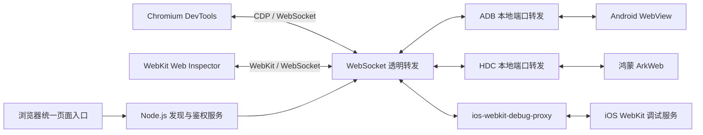

# cdp-native 功能、使用与三端协议实现原理

本文基于仓库当前 0.1.0 版本源码，面向工具使用者和维护者。说明的是项目实际实现，不代表所有系统版本或设备均已完成真机验证。

## 1. 工具定位与功能

cdp-native 是本地网页调试服务：把手机中的可调试网页列在统一入口，再打开适配该网页引擎的调试前端。服务由 Node.js 运行，浏览器提供操作界面，手机负责执行被调试页面。

| 对象 | 连接工具 | 调试前端 | 页面调试协议 |
| --- | --- | --- | --- |
| Android WebView | ADB | 随包 Chromium DevTools | CDP |
| 鸿蒙 ArkWeb | HDC | 随包 Chromium DevTools | CDP |
| iOS WKWebView / Safari | ios-webkit-debug-proxy | 启动时自动准备的 WebKit Web Inspector | WebKit Inspector |
| 已有 CDP HTTP 端点 | 直接连接 | Chromium DevTools | CDP |

主要功能：

- 自动检测 Android/鸿蒙设备、发现应用调试 socket，并建立本地端口转发。
- 聚合同一设备多个可调试进程的网页；支持按设备序列号和应用进程名筛选。
- 通过调试前端进行 JavaScript 断点、单步、变量查看，以及前端和目标引擎支持的 DOM、Console、Network 等操作。
- 页面列表定期刷新；再次发现时检查转发状态，处理设备重连、进程退出与新进程出现。
- 在统一列表中展示 iOS 页面，并选择 WebKit 前端打开。
- 检测、复用或按平台下载连接工具；使用访问令牌保护页面发现和 WebSocket 调试接口。

能力边界：这里的 Native 指直接连接设备提供的调试接口，并不意味着可以调试 Java、Kotlin、Swift、Objective-C 或 ArkTS 原生业务代码。工具不会替第三方应用开启 WebView 调试权限，也不注入脚本来绕过权限。面板是否可用取决于前端版本、目标引擎协议和应用配置。

## 2. 安装与使用

### 2.1 环境与通用流程

需要 Node.js 20 或更新版本。源码运行：

```sh
npm ci
npm link
cdp-native
```

已有打包文件时：

```sh
npm install -g cdp-native@0.1.0
cdp-native
```

运行 `cdp-native` 后默认打开调试页面，自动传递启动时生成的访问令牌并建立连接，无需手动输入。使用 `--no-open` 时，打开终端打印的完整链接即可自动连接。连接并解锁手机、完成授权、打开目标网页，列表出现后点击 Inspect。列表约每 3 秒检测一次；Ctrl+C 结束服务。

CLI 只监听 `127.0.0.1`。可用 `CHII_CDP_TOKEN` 设置至少 16 字符的固定令牌；未设置时每次启动生成随机令牌。

### 2.2 Android

手机需要开启 USB 调试并授权电脑；应用需要启用 WebView 调试，例如：

```java
WebView.setWebContentsDebuggingEnabled(true);
```

**注意事项：** 请先打开 Android App 中的 WebView 页面，然后在 Native 提供的原生 WebView 中访问 `https://www.baidu.com`，保持该页面打开，再通过调试列表选择对应页面进行调试。

```sh
cdp-native --device-type adb
cdp-native --device-type adb --adb-serial SERIAL --adb-package com.example.app
cdp-native --adb-path /path/to/adb --no-download --no-open
```

ADB 优先复用指定路径、SDK、PATH 或缓存中的工具。缺失时从 Google 下载 Platform-Tools；默认缓存为 `~/.cache/cdp-native/<系统>-<架构>`，可通过 `CHII_ADB_CACHE` 修改。自动下载覆盖 macOS x86-64/arm64、Windows x64、Linux x64；其他架构需自行提供工具。

### 2.3 鸿蒙 / HDC

设备需要开启并授权 USB 调试，应用需要允许 ArkWeb 调试：

```ts
webview.WebviewController.setWebDebuggingAccess(true);
```

```sh
cdp-native --device-type hdc
cdp-native --device-type hdc --hdc-serial SERIAL --hdc-package com.example.app
cdp-native --device-type hdc --hdc-path /path/to/hdc
```

HDC 会从显式配置、SDK/DevEco 常见目录、PATH 和缓存中检测。内置自动下载覆盖 macOS x86-64/arm64、Windows x64，使用固定版本第三方工具包并校验 SHA-256；Linux 等平台需要自行安装 SDK 工具。缓存可通过 `CHII_HDC_CACHE` 配置。

默认 `auto` 在 ADB/HDC 候选设备中选择唯一设备；候选不唯一时要求指定类型及序列号。选定后保持同一设备及传输方式，断开不会自动切到另一台手机。

### 2.4 iOS

使用 `cdp-native --device-type ios` 启动时，会先检测 WebKit 前端：已安装则直接启动，缺失则自动下载准备后继续启动。指定外部 iOS 代理时同样执行检查；`--no-download` 会禁止自动下载。通常无需单独执行安装命令：

```sh
cdp-native --device-type ios
```

如需提前下载前端，也可手动执行：

```sh
cdp-native setup:webkit
```

该命令需要通过 Git 访问 GitHub，会显示当前下载步骤和传输进度。网络连续 60 秒无有效传输或单步超过 5 分钟会报错退出；遇到下载失败，请检查 Git 的网络/代理配置后重试。离线准备时，可通过 `CHII_WEBKIT_SOURCE` 和 `CHII_WEBKIT_KIT_SOURCE` 分别指定 WebKit 与 ios-safari-remote-debug-kit 的本地源码目录。

自动安装与手动安装共用同一下载流程，需要 Git，默认生成安装目录下的 `public/webkit`。npm 发布包不包含该目录和 Windows iOS 代理 ZIP；首次启动需要联网，后续复用已安装资源。也可通过 `--webkit-frontend /path/to/UserInterface` 或 `CHII_WEBKIT_FRONTEND` 指定前端目录，启动时会检查该目录，缺失时尝试安装到该位置。使用 `--no-download` 时，前端缺失会报错退出。

macOS 可先安装代理，然后启动 iOS 模式：

```sh
brew install ios-webkit-debug-proxy
cdp-native --device-type ios
```

不指定外部代理 URL 时，iOS 模式会准备并启动代理，管理自己启动的进程。Windows x64 从远端下载代理包并校验 SHA-256，需要 Apple Mobile Device Support；macOS/Linux 优先使用已安装代理，未内置对应下载包时可通过 `--ios-proxy-manifest` 提供下载清单。

也可以自己管理代理，在两个终端分别执行：

```sh
# 终端一
ios_webkit_debug_proxy --no-frontend
```

```sh
# 终端二
cdp-native --device-type ios --ios-proxy http://127.0.0.1:9221
```

指定 `--ios-proxy` 时，本服务不管理外部代理进程。要同时展示 ADB/HDC 所选设备与 iOS 页面：

```sh
cdp-native --ios-proxy http://127.0.0.1:9221
```

手机需要解锁、信任电脑并开启 Safari 的 Web Inspector。WKWebView 应用还需允许检查，例如：

```swift
if #available(iOS 16.4, *) {
    webView.isInspectable = true
}
```

在列表点击 **Inspect · WebKit**。默认展示代理发现的所有 iOS 设备页面，使用 `--ios-serial UDID` 可筛选。WebKit 前端与系统协议可能存在版本差异，需要在目标真机验证所需面板；准备前端时可通过 `CHII_IOS_PROTOCOL_VERSION` 选择源码提供的协议版本。

### 2.5 常用参数

| 参数 | 作用 |
| --- | --- |
| `--port 8090` | 修改本地网页服务端口 |
| `--device-type auto/adb/hdc/ios` | 选择设备模式，默认 auto；auto 不会单独自动启用 iOS |
| `--adb-path` / `--hdc-path` | 指定连接工具 |
| `--adb-serial` / `--hdc-serial` | 指定设备 |
| `--adb-package` / `--hdc-package` | 按进程名查 PID，筛选对应 socket |
| `--ios-proxy` | 指定外部代理设备列表地址 |
| `--ios-proxy-path` / `--ios-proxy-manifest` | 指定代理程序或下载清单 |
| `--ios-serial` / `--webkit-frontend` | 筛选 iOS 设备或指定前端目录 |
| `--cdp http://127.0.0.1:9222` | 直连已有 CDP 端点，跳过 ADB/HDC 准备 |
| `--no-download` | 禁止自动下载连接工具 |
| `--no-open` | 不自动打开浏览器 |

ADB/HDC 的路径、序列号和进程名分别支持 `CHII_ADB_PATH/SERIAL/PACKAGE`、`CHII_HDC_PATH/SERIAL/PACKAGE` 环境变量。iOS 支持 `CHII_IOS_PROXY`、`CHII_IOS_SERIAL`、`CHII_WEBKIT_FRONTEND`；已有 CDP 地址支持 `CHII_CDP_URL`。

## 3. 三端协议与通信链路

### 3.1 区分传输通道与调试协议

ADB、HDC 负责设备管理、shell 命令和端口转发，不是页面调试协议。CDP 和 WebKit Inspector 才表达“设置断点”“执行表达式”“接收暂停事件”等调试语义。WebSocket 是本服务与调试端点之间承载这些消息的连接方式。



### 3.2 Android：ADB 通道与 CDP

1. 执行 `adb start-server`、`adb devices`，筛选状态为 `device` 的设备。
2. 执行 `adb -s SERIAL shell cat /proc/net/unix`，寻找 `webview_devtools_remote*` 抽象 Unix socket。
3. 配置进程筛选时执行 `pidof`，匹配 `webview_devtools_remote_<PID>`。
4. 执行 `adb -s SERIAL forward tcp:0 localabstract:SOCKET`，由 ADB 分配本地端口。
5. 对每个端口请求 `/json/list`，保留有 WebSocket 地址的 `page` 类型目标。
6. DevTools 连接本服务，本服务连接所选页面的上游 WebSocket，双向转发 CDP。

CDP 消息通常含 `id`、`method`、`params`，响应用相同 `id` 关联请求，事件通过 `method` 表达。以下仅用于解释消息结构：

```json
{"id":1,"method":"Debugger.enable"}
{"id":1,"result":{}}
```

前端收到暂停事件后展示调用栈、作用域和变量；用户单步或继续时发送相应调试命令。实际调试动作由手机引擎完成，Node.js 不执行被调试代码。

### 3.3 鸿蒙：HDC 通道与 CDP

流程与 Android 类似，设备命令改为 HDC：

```sh
hdc list targets
hdc -t SERIAL shell cat /proc/net/unix
hdc fport ls
hdc -t SERIAL fport tcp:PORT localabstract:webview_devtools_remote_PID
```

项目先通过本机临时监听获得空闲端口，关闭监听后再创建 HDC 转发；遇到端口占用最多尝试三次。成功标识为 `Forwardport result:OK`。之后同样请求 `/json/list` 并转发 CDP，不存在 HDC 到 CDP 的消息翻译层。

HDC 常规命令使用 `-p` 避免重复启动探测；连接服务失败时尝试启动服务，设备查询发生特定超时时尝试 `start -r` 后重试。

### 3.4 iOS：代理桥接与 WebKit Inspector

1. 请求代理设备列表端口的 `/json`，默认地址为 `http://127.0.0.1:9221`。
2. 根据 `deviceId` 筛选设备，从列表中取出每台设备的代理端口。
3. 请求每台设备端口的 `/json`，取得页面及 `webSocketDebuggerUrl`。
4. 目标标记为 `frontend: webkit`，打开 `webkit/Main.html`。
5. 本服务透明转发 WebSocket，由外部代理负责连接 iOS 调试服务。

WebKit Inspector 与 CDP 都采用命令、响应和事件式交互，但方法、参数和版本演进不能视为完全兼容。本项目不做协议转换，因此 iOS 使用独立 WebKit 前端。iOS 设备侧通信细节由代理及其依赖实现，不属于本仓库的实现范围。

## 4. 服务实现原理

### 4.1 模块职责

| 文件 | 职责 |
| --- | --- |
| `bin/cdp-native.js` | 解析参数、生成令牌、准备工具、启动监听及浏览器 |
| `server/index.js` | 组装 Koa 路由、静态资源、设备提供者及 WebSocket upgrade |
| `server/lib/DeviceCdp.js` | ADB/HDC 候选选择与设备保持 |
| `server/lib/AdbCdp.js`、`HdcCdp.js` | 发现 socket、维护转发、返回 HTTP 端点 |
| `server/lib/IosWebKit.js` | 两级 iOS 设备/页面发现 |
| `server/lib/CdpBridge.js` | 登录鉴权、目标聚合、目标校验与双向转发 |
| `server/tpl/cdp.hbs` | 登录、页面列表、刷新与 Inspect 链接 |
| `server/lib/prepare*.js` | 连接工具检测、下载与缓存 |
| `server/lib/prepareWebkit.js` | iOS 启动时检查前端，缺失时自动安装 |
| `server/lib/startIosProxy.js` | iOS 代理进程生命周期 |
| `scripts/setup-webkit.js` | 准备 WebKit 前端与浏览器兼容补丁 |

### 4.2 从登录到调试

默认路由包括 `/cdp/`、`POST /cdp/login`、`GET /cdp/targets` 和 `/cdp/socket?id=...`。用户提交令牌后，服务用基于令牌和路径生成的 HMAC 会话值设置 HttpOnly、SameSite=Strict Cookie。目标查询与 WebSocket 握手均校验会话；登录和握手还会检查请求携带的 Origin 与 Host 是否匹配。

浏览器只提交目标 ID，不能直接指定任意上游 URL。握手时服务重新发现目标、查找 ID，再使用受控端点的主机和端口拼接目标声明的 WebSocket 路径与查询串。iOS 注册信息同样只能提供设备端口，不能替换配置的代理主机。

### 4.3 多进程、失败与恢复

不同进程可能返回相同页面 ID，因此 CDP 目标使用“进程 socket 名 + 页面 ID”生成复合 ID；iOS 使用“ios + UDID + 页面 ID”。多个端点通过 `Promise.allSettled` 聚合，一部分失败时仍返回其他成功页面；所有端点失败才整体报错。这也意味着列表中缺少部分页面不一定会显示整体错误。

每次发现都会检查转发列表，清理已消失 socket 的本实例映射，并补建丢失转发。`ensure()` 合并同时进行的连接工作，避免重复创建。关闭设备提供者时保留转发，代码明确用此策略避免与新服务实例发生删除竞态。

恢复转发不等于恢复原调试会话：应用重启导致旧页面消失后，通常需要重新选择新页面并打开 Inspect。

### 4.4 消息透传与资源限制

桥接器不解析或改写调试消息，保留文本/二进制标识、请求 ID、会话 ID 和事件。任一连接关闭或异常时关闭另一端。上游握手与 HTTP 发现超时为 5 秒；WebSocket 最大消息载荷为 32 MiB，发送积压超过 8 MiB 时关闭慢连接。这些措施限制挂起和积压，不构成协议兼容性保证。

## 5. 常见问题与验证

| 现象 | 排查方向 |
| --- | --- |
| 一直等待设备 | 检查 USB、解锁、授权；确认 adb devices 或 hdc list targets 可见 |
| 已连接但等待 WebView/ArkWeb | 打开目标网页，确认应用启用调试；核对进程名筛选 |
| 提示多台设备 | 指定 device-type 和对应 serial |
| iOS 代理无法连接 | 检查代理进程与设备列表端口；此错误本身不能证明手机未授权 |
| iOS 缺少前端 | iOS 启动时会自动安装；若使用了 `--no-download`，请先手动运行 `cdp-native setup:webkit` 或指定已安装的前端目录 |
| WebKit 自动安装失败 | 检查 Git、GitHub 网络/代理及目标目录写入权限，解决后重新启动 iOS 模式 |
| iOS 页面有列表但面板异常 | 核查 WebKit 前端与系统协议版本，做真机验证 |
| 重启应用后旧 Inspect 断开 | 等待列表更新，重新打开新页面 |
| 工具下载失败 | 检查网络，或指定本地工具路径并使用 no-download |

测试、构建和分发打包属于源码维护流程，具体脚本见 `package.json` 的 `scripts` 配置。自动化检查不能代替三端真机验证：至少检查页面发现、Inspect、断点、单步、变量查看、设备重连和应用重启。

WebKit 前端包含来自 GPL-3.0 项目的兼容补丁，WebKit 源文件保留各自许可；准备和分发时应保留生成目录中的许可及 PROVENANCE.txt。ADB、HDC 和 iOS 代理也各有自身分发与运行依赖，详细安装说明见仓库 README。

在 macOS ARM64 上，`npm run setup:webkit`（或 `cdp-native setup:webkit`）会优先复用已安装的 iOS 代理；缺失时通过 Homebrew 安装 `ios-webkit-debug-proxy` 及其依赖。请先安装 Homebrew。已有 WebKit 前端时会跳过前端下载，仍会检查代理。

使用 `npm start -- --device-type ios` 启动时，会检测 iOS 代理是否可运行，兼容 Intel Mac x86-64 和 Apple Silicon（arm64）。检测 PATH 后优先检查当前架构对应的 Homebrew 目录，并兼容另一安装目录；缺少代理时，arm64 提示运行 `setup:webkit`，Intel Mac 提示运行 `brew install ios-webkit-debug-proxy`。
